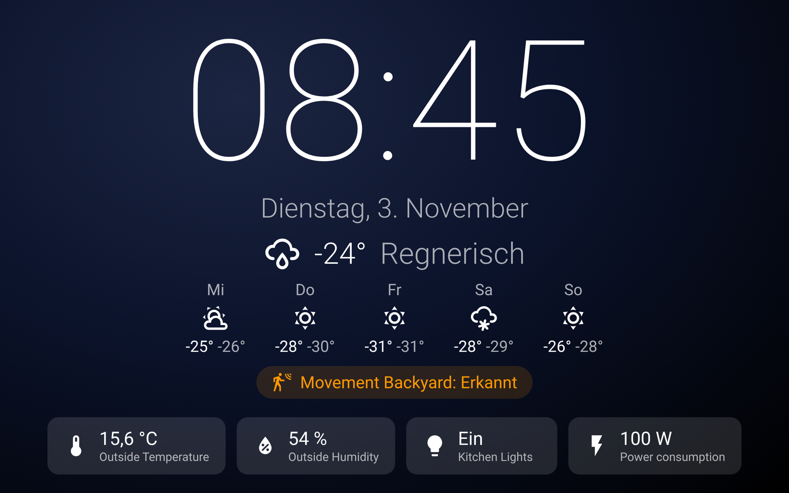

# Modular Screensaver

[](https://hacs.xyz)
[](https://github.com/Hettinger91/Modular-Screensaver-/actions/workflows/validate.yml)

Konfigurierbarer Bildschirmschoner für Home-Assistant-Dashboards – ideal für Wand-Tablets.
Komplett über die Oberfläche einstellbar, keine Ressource, kein YAML, keine Karte nötig.



## Funktionen

- Startet nach einstellbarer Zeit ohne Berührung, Tippen beendet ihn (der Tipp löst nichts im Dashboard aus)
- **Uhr** (24 h / 12 h, optional Sekunden, Größe einstellbar) und **Datum**
- **Wetter** (beliebige `weather`-Entität) mit **Vorhersage** (1–7 Tage)
- **Werte beliebiger Entitäten** als Kacheln (Symbol, Name, Wert)
- **Hinweise**: Entitäten, die nur erscheinen, wenn sie aktiv sind (Fenster offen, Bewegung, Rauch, DWD-Warnstufe > 0 …) –
  bei DWD-Warnungen werden die Warnungstexte angezeigt
- Hintergrund schwarz, dunkler Verlauf oder eigenes Bild; Schriftfarbe; Software-Abdunkelung
- **Einbrennschutz**: Inhalt wandert langsam
- Nur für bestimmte **Benutzer** und/oder bestimmte **Dashboards** (Einstellungsseiten sind immer ausgenommen)
- **Display-Helligkeit** über eine Licht-Entität (z. B. TouchKio): dimmen beim Start, zurück beim Tippen,
  **Nachtmodus** (Display aus / nur dimmen) in einem Zeitfenster
- Entitäten für Automationen:
  - `switch.modular_screensaver_aktiv` – Schoner ein/aus
  - `binary_sensor.modular_screensaver_sichtbar` – Schoner wird gerade angezeigt
- Dienste `modular_screensaver.show` und `modular_screensaver.hide` (z. B. beim Klingeln ausblenden)
- Änderungen an den Einstellungen wirken sofort, ohne Neuladen des Tablets

## Installation (HACS)

[](https://my.home-assistant.io/redirect/hacs_repository/?owner=Hettinger91&repository=Modular-Screensaver-&category=integration)

1. Button oben klicken – oder HACS → ⋮ → **Benutzerdefinierte Repositories** →
   `https://github.com/Hettinger91/Modular-Screensaver-`, Typ **Integration**
2. „Modular Screensaver“ herunterladen, Home Assistant **neu starten**
3. Einstellungen → Geräte & Dienste → **Integration hinzufügen** → „Modular Screensaver“
4. Bei der Integration auf **Konfigurieren** klicken und die Bereiche einstellen:
   - **Allgemein** – Zeit, Benutzer, Dashboards
   - **Inhalt** – Uhr, Datum, Wetter, Entitäten, Hinweise
   - **Aussehen** – Hintergrund, Farbe, Größe, Einbrennschutz
   - **Display** – Helligkeits-Entität, Nachtmodus
5. Das Tablet einmal neu laden (nur nach der Erstinstallation nötig).

## Tipps

- Für ein Wand-Tablet einen eigenen Benutzer anlegen und unter *Allgemein → Nur für diese Benutzer* nur diesen wählen.
  Dann bekommt dein PC/Handy keinen Schoner.
- Dashboards einschränken: kommagetrennte URL-Anfänge, z. B. `/dashboard-home, /wand-tablet`.
- Eigenes Hintergrundbild: Datei nach `/config/www/` legen und als `/local/datei.jpg` eintragen.
- Klingel-Beispiel:

```yaml
triggers:
  - trigger: state
    entity_id: binary_sensor.klingel
    to: "on"
actions:
  - action: modular_screensaver.hide
```

## Fehlersuche

In der Browser-Konsole des Tablets `modularScreensaver()` eingeben – zeigt, ob der Schoner für diesen
Benutzer/Pfad aktiv ist und welche Einstellungen ankommen.

## Hinweis bei Umstieg von einem alten Screensaver-Skript

Ein bisheriges eigenes Screensaver-Modul (Dashboard-Ressource) vorher entfernen, sonst laufen beide.

## Voraussetzungen

Home Assistant 2025.1 oder neuer. Getestet mit 2026.10.

## Lizenz

MIT
